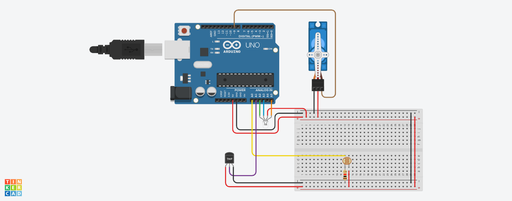

# Quarto Inteligente - Edge Computing & Systems

<p align="left">
  
</p>

## Integrantes
- Anita Palhares
- Kauã Coelho
- Vitória Kereski

## Descrição do Projeto

O **Quarto Inteligente** é um sistema de automação e sensoriamento desenvolvido para monitoramento ambiental e controle contextual de atuadores. O sistema foi concebido como uma arquitetura IoT modular dividida em duas camadas:

1. **Camada de Borda/Controle (Arduino Mega 2560):** Responsável pela aquisição analógica e digital de sensores (temperatura e luminosidade), validação das grandezas físicas, acionamento concorrente de atuadores sem chamadas bloqueantes (`millis`), salvaguarda via Watchdog Timer e formatação da telemetria.
2. **Camada de Conectividade/Gateway (ESP32 Mock C++20):** Responsável por estabelecer a interface serial (UART 8N1 a 9600 baud) com o microcontrolador, validar e decodificar os frames de dados, traduzir os atributos para a sintaxe UltraLight 2.0 e publicar os estados no broker MQTT integrado à plataforma FIWARE.

> O ESP32 é **simulado pelo computador**, com o simulador `ESP32_mqtt_mock` (C++), que oferece a mesma API de `Serial` e `PubSubClient` do ESP32.

```
Arduino --UART (USB)--> ESP32 simulado --MQTT--> Mosquitto --> IoT Agent --> Orion (FIWARE)
        <------ ACK ---
```

## Montagem

### Circuito Tinkercad


#### Link de Acesso Tinkercad: https://www.tinkercad.com/things/hbOkdBg5dWO-anita-segundo-semestre-edge

## Arquitetura de Hardware

### Componentes Utilizados
- **Microcontrolador:** Arduino Mega 2560.
- **Sensores:**
  - Sensor de Temperatura DHT11 (protótipo físico). No Tinkercad, que não tem o DHT11, a simulação usa um sensor de temperatura analógico.
  - Sensor de Luminosidade LDR em divisor de tensão resistivo.
- **Atuadores:**
  - Servomotor (Pino 9 / PWM): simula controle automatizado de climatização (ar-condicionado).
  - LED RGB Ânodo Comum / Cátodo Comum configurável (Pinos 10, 11 e 12 / PWM): simula iluminação adaptativa com efeito visual de discoteca em situações de baixa luminosidade.

### Mapeamento de Pinos (Pinout)
| Componente | Tipo | Pino no Arduino Mega | Descrição / Sinal |
| :--- | :--- | :--- | :--- |
| **DHT11** | Entrada Digital | Pino 6 | Barramento de dados 1-Wire com resistor pull-up |
| **LDR** | Entrada Analógica | Pino A1 | Tensão proporcional à iluminação (0 a 1023) |
| **Servo Motor** | Saída Digital (PWM) | Pino 9 | Sinal de controle de ciclo de trabalho |
| **LED RGB (Vermelho)** | Saída Digital (PWM) | Pino 12 | Canal Red PWM |
| **LED RGB (Verde)** | Saída Digital (PWM) | Pino 11 | Canal Green PWM |
| **LED RGB (Azul)** | Saída Digital (PWM) | Pino 10 | Canal Blue PWM |
| **UART0 (USB)** | Comunicação Bidirecional | TX0 (Pino 1) / RX0 (Pino 0) | Conexão serial com PC / Gateway ESP32 Mock |

> Com um ESP32 físico, a ligação passa a ser pela `Serial1` do Mega (TX1 = pino 18, RX1 = pino 19).

### Esquemas de Montagem e Simulação
- **Circuito Tinkercad:** Simulação funcional com Arduino Uno, sensor analógico e componentes discretos.
  [Acessar Projeto no Tinkercad](https://www.tinkercad.com/things/hbOkdBg5dWO-anita-segundo-semestre-edge)

## Funcionamento

As leituras acontecem a cada **5 segundos**.

### Controle de Temperatura
- Temperatura > 26°C:
  - Servo é ativado.
  - Movimento contínuo entre 0° e 90°.
- Temperatura < 25°C:
  - Servo é desativado.
  - Retorna para 0°.

### Controle de Luminosidade
- Luz abaixo do limite configurado (400, em uma escala de 0 a 1023):
  - LED RGB entra em modo discoteca.
  - Cores alternadas aleatoriamente, a cada 500 ms.
- Luz acima do limite:
  - LED RGB permanece desligado.

### Validação das Leituras
- Temperatura válida entre -20 °C e 100 °C (o DHT11 devolve `NaN` quando falha). Luz válida entre 1 e 1022 (0 e 1023 indicam sensor desconectado ou em curto).
- Com leitura inválida, o sistema mostra o erro, **não** altera o atuador correspondente e envia `NA` no campo.

## Monitor Serial
A cada leitura, o sistema exibe um bloco numerado com:
- Temperatura atual.
- Nível de luminosidade.
- Mudanças de estado do servo e do LED RGB.
- Mensagens de erro em falhas de leitura.
- A mensagem enviada ao ESP32 e o resultado da comunicação (`ESP32 : OK` ou `ERRO`).

```text
==================================================
LEITURA #8
==================================================
  Temperatura : 29.0 C
  Luz         : 370
>> SERVO (AR-CONDICIONADO) LIGADO
  Servo (AR)  : LIGADO
  LED RGB     : desligado
--------------------------------------------------
DADOS,29.0,370,1,0
  ESP32       : OK
==================================================
```

---

## Protocolo de Comunicação Serial (Arduino E ESP32)

A camada de enlace entre o Arduino Mega e o ESP32 Mock opera através da interface UART configurada em **9600 baud, 8 bits de dados, sem paridade e 1 stop bit (8N1)**.

### Estrutura do Pacote de Telemetria (Arduino → ESP32)
O envio ocorre periodicamente a cada 5 segundos. O frame é textual com delimitadores por vírgula e terminador em quebra de linha `\n`:

```text
DADOS,<temperatura>,<luz>,<servo>,<led>\n
```

| Campo | Valores |
| :--- | :--- |
| `temperatura` | decimal com 1 casa (°C), ou `NA` se a leitura for inválida |
| `luz` | inteiro de 0 a 1023, ou `NA` se a leitura for inválida |
| `servo` | `1` servo ligado, `0` desligado |
| `led` | `1` modo discoteca ligado, `0` desligado |

Exemplos: `DADOS,26.8,421,1,0` e `DADOS,NA,300,0,1`. Os campos correspondem à struct `EstadoSensores` do Arduino.

### Confirmação (ESP32 → Arduino)

```text
ACK\n
```

O ESP32 envia o `ACK` **somente depois de publicar a mensagem no MQTT com sucesso**.

### Validação da Comunicação
1. O Arduino envia `DADOS,...` e aguarda o `ACK`, sem bloquear o programa (usa `millis`).
2. **Com o `ACK` em até 2 s:** comunicação OK (`ESP32 : OK`).
3. **Sem o `ACK` em 2 s:** o Arduino trata como perda de comunicação, mostra `ESP32 : ERRO - sem resposta (comunicacao perdida)` e marca `comunicacaoOk = false` na struct. Sensores e atuadores continuam funcionando.
4. O ESP32 ignora as linhas que não começam com `DADOS` (mensagens de debug do Arduino) e descarta as linhas inválidas (número de campos errado, valor não numérico, servo ou LED diferente de `0` e `1`), sem enviar `ACK`. Se o broker MQTT estiver fora do ar, ele também não envia `ACK`.

---

## Dados Enviados por MQTT

| Item | Valor |
| :--- | :--- |
| Broker | `localhost`, porta `1883` (Mosquitto do FIWARE) |
| Tópico de publicação | `/TEF/quarto001/attrs` |
| Formato | UltraLight 2.0 (pares `atributo\|valor` separados por `\|`) |
| Frequência | a cada 5 segundos |

| Atributo enviado | Atributo no FIWARE | Tipo | Significado |
| :--- | :--- | :--- | :--- |
| `t` | `temperatura` | Float | Temperatura em °C |
| `l` | `luminosidade` | Integer | Leitura do LDR (0 a 1023) |
| `s` | `servo` | Integer | `0` desligado, `1` ligado |
| `d` | `led` | Integer | `0` desligado, `1` modo discoteca |

Exemplo de mensagem: `t|26.8|l|421|s|1|d|0`. Quando uma leitura é inválida (`NA`), o atributo correspondente **não é enviado** naquela mensagem, e o FIWARE mantém o último valor válido (ex.: `l|421|s|0|d|1`).

---

## Ambiente e Ferramentas

| Ferramenta | Onde roda | Para quê |
| :--- | :--- | :--- |
| **VS Code + PlatformIO** | Windows | Compilar e gravar o firmware do Arduino |
| **PowerShell** (como administrador) | Windows | Comandos do `usbipd`, que liga o Arduino ao WSL |
| **usbipd-win** | Windows | Compartilhar a porta USB do Arduino com o WSL |
| **WSL2 (Ubuntu)** | Windows | Docker, FIWARE e o simulador do ESP32 |
| **Docker + Docker Compose** | Ubuntu (WSL) | Rodar o FIWARE |
| **CMake, g++ e Paho MQTT** | Ubuntu (WSL) | Compilar o simulador do ESP32 |
| **Postman (aplicativo desktop)** | Windows | Cadastrar o dispositivo e consultar o FIWARE |


## Como Executar

Cada passo indica onde o comando é executado. Os comandos do `usbipd` só funcionam no **PowerShell**, e os de `docker` e do simulador, no **Ubuntu (WSL)**.

**1. Gravar o Arduino (VS Code, Windows).** Abra a pasta `Arduino/quarto_inteligente_pio`, compile e grave pelo PlatformIO. Depois **feche o Serial Monitor**, pois a porta USB só aceita um programa por vez.

**2. Subir o FIWARE (Ubuntu).** Na pasta `fiware`:
```bash
sudo service docker start
sudo docker compose up -d
sudo docker ps            # os 6 containers devem estar "Up"
```

**3. Cadastrar o dispositivo (Postman, só na primeira vez).** 
- `POST http://localhost:4041/iot/services`, para criar o service group:
  ```json
  { "services": [ { "apikey": "TEF", "cbroker": "http://orion:1026", "entity_type": "Thing", "resource": "" } ] }
  ```
  O `cbroker` usa `orion` porque o IoT Agent roda dentro do Docker, onde `localhost` seria ele mesmo.
- `POST http://localhost:4041/iot/devices`, para cadastrar o dispositivo:
  ```json
  { "devices": [ { "device_id": "quarto001", "entity_name": "urn:ngsi-ld:Quarto:001", "entity_type": "Quarto",
      "protocol": "PDI-IoTA-UltraLight", "transport": "MQTT",
      "attributes": [
        { "object_id": "t", "name": "temperatura",  "type": "Float" },
        { "object_id": "l", "name": "luminosidade", "type": "Integer" },
        { "object_id": "s", "name": "servo",        "type": "Integer" },
        { "object_id": "d", "name": "led",          "type": "Integer" } ] } ] }
  ```

**4. Anexar o Arduino ao WSL (PowerShell como administrador).**
```powershell
usbipd list                                  # procure o "USB-SERIAL CH340" e anote o BUSID
usbipd bind --busid=<BUSID>                  # só na primeira vez
usbipd attach --wsl --busid=<BUSID>
```
No Ubuntu, confira o nome da porta: `ls /dev/ttyUSB* /dev/ttyACM*`. Com o chip CH340 costuma ser `/dev/ttyUSB0` ou `/dev/ttyUSB1`, e o número pode mudar a cada `attach`.

**5. Rodar o simulador do ESP32 (Ubuntu).** Na pasta `ESP32_mqtt_mock`:
```bash
./build_and_run.sh /dev/ttyUSB0              # use a porta do passo 4; com "permission denied", use sudo
```
O terminal mostra as leituras do Arduino (`[Arduino]`), as publicações (`[MQTT] Enviado`) e `ESP32 : OK`.

**6. Conferir os dados no FIWARE.** Pelo Postman ou pelo terminal:
```bash
curl -s -H "fiware-service: smart" -H "fiware-servicepath: /" \
  "http://localhost:1026/v2/entities/urn:ngsi-ld:Quarto:001?options=keyValues"
```

**Para encerrar:** `Ctrl+C` no simulador. Para gravar o Arduino de novo pelo Windows, devolva a porta com `usbipd detach --busid=<BUSID>` (PowerShell).

## Simulador do ESP32

O projeto utiliza o `ESP32_mqtt_mock`, um simulador em C++ disponibilizado no repositório de aulas do professor Guilherme Salati. Ele representa o funcionamento do ESP32 no computador, permitindo testar a comunicação serial com o Arduino e o envio de dados para o broker MQTT sem precisar de um ESP32 físico.

O firmware responsável pela integração está em `ESP32_mqtt_mock/src/esp32.cpp`. O simulador também recebeu ajustes para melhorar a leitura dos dados seriais, o funcionamento da comunicação MQTT, a configuração da porta serial e o encerramento do programa.

## Resultado Esperado

Ao executar o projeto, o Arduino realiza as leituras dos sensores de temperatura e luminosidade e controla os atuadores de acordo com as condições programadas. Os dados são enviados pela comunicação serial ao gateway simulado, que valida as informações e publica os valores válidos por MQTT.

Com a integração ao FIWARE, é possível consultar os dados enviados pelo sistema e acompanhar as informações coletadas durante a execução.

Dessa forma, o **Quarto Inteligente** demonstra a integração entre sistemas embarcados, sensores, atuadores, comunicação serial, MQTT e uma plataforma de gerenciamento de dados IoT, aplicando conceitos de Edge Computing na automação e no monitoramento de ambientes. 
